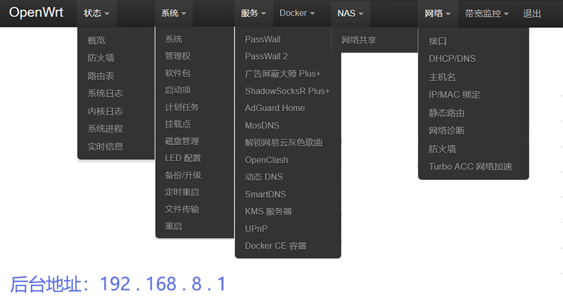
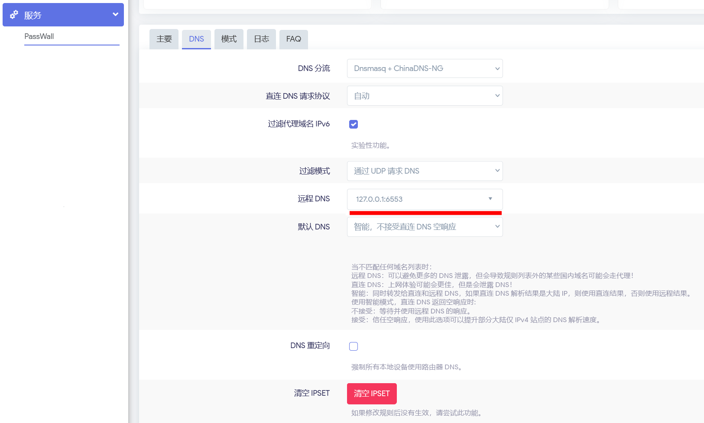
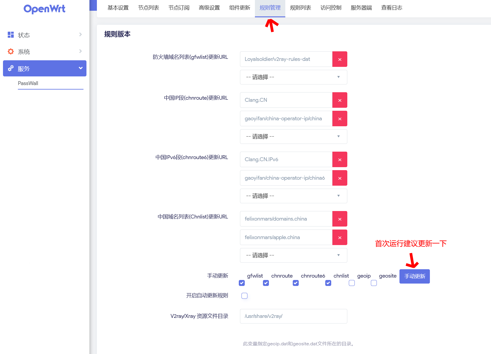
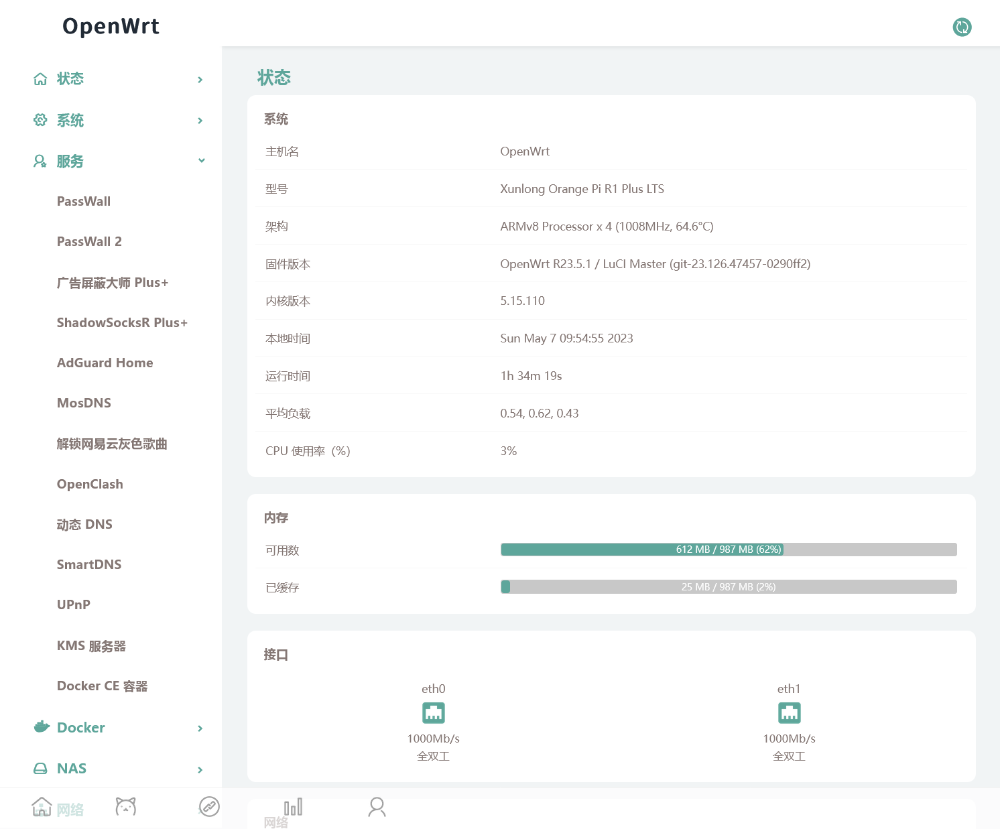

# Actions-lede

> 用 GitHub Actions 编译 [coolsnowwolf/lede](https://github.com/coolsnowwolf/lede)（Lean's OpenWrt）固件。
>
> 目录结构照 `Actions-immortalwrt-optimized` 改成了「1 份 reusable workflow + 每个平台一个 20~40 行的调用方」。
> 具体改了什么、为什么改、哪些地方我**故意没动**，都写在 [优化说明.md](优化说明.md) 里，建议先看那个。

---

## 目录结构

| 文件夹 | 用途 |
| --- | --- |
| `.github/workflows/build.yml` | **唯一一份编译流程**（reusable workflow），所有平台都调它 |
| `.github/workflows/*.yml`（其余） | 各平台的"开关"，只有 20~40 行，负责定时/手动触发并传参 |
| `.github/workflows/Auto-Clean.yml` | 定时清理 Release 和流水线记录（用 `gh` CLI，不依赖第三方 action） |
| `.github/dependabot.yml` | 自动跟进 action 版本 |
| `configs/Target-*.txt` | 设备/平台配置（选哪些型号出固件） |
| `configs/Packages*.txt` | 插件配置（`Packages.txt` 全量 / `Packages-L.txt` 精简 / `Packages-5G.txt` 5G / `Packages-storage.txt` 存储） |
| `files/etc` | 随固件下发的内置配置（目前是 smartdns） |
| `patches/vlmcsd` | 覆盖 feeds 里的 vlmcsd |
| `patches/r1pluslts` | R1 Plus LTS 的 dts（**当前没有接线**，见优化说明） |
| `scripts/` | 各个构建阶段的脚本，全部约定"在 openwrt 源码根目录执行" |
| `doc/` | README 用的截图 |

---

## 编译计划

| 北京时间 | 平台 | workflow | 源码分支 | 编译方式 |
| --- | --- | --- | --- | --- |
| 周一 04:00 | Allwinner | `allwinner.yml` | master | single |
| 周三 04:00 | Rockchip | `rockchip.yml` | master | single |
| 周三 06:00 | 香橙派 R1 Plus（Docker） | `r1pluslts-docker.yml` | master | single |
| 周五 04:00 | X86-64 | `x86-64.yml` | master | single |
| 周日 04:00 | — | `Auto-Clean.yml`（清理 Release/流水线记录） | — | — |

`mtk_filogic.yml`（MTK Filogic）和 `mt7621.yml`（ramips MT7621）的定时**保持原样：已注释掉**，
只能手动 `workflow_dispatch` 触发。Filogic 设备多、一次全编很容易撞 6 小时上限；
MT7621 在原作者那里也是停掉定时的，这里不擅自恢复。

---

## 各平台参数（要改就改这里）

| workflow | platform | branch | configs | OpenClash 内核 | vlmcsd | 5G | homeproxy 规则 |
| --- | --- | --- | --- | --- | --- | --- | --- |
| `x86-64.yml` | `x86-64` | master | Target-X86 + Packages + Packages-storage + Packages-5G | amd64 | ✓ | ✓ | ✓ |
| `allwinner.yml` | `allwinner` | master | Target-allwinner + Packages-L + Packages-5G | arm64 | ✓ | ✓ | ✓ |
| `rockchip.yml` | `rockchip` | master | Target-rockchip-L + Packages + Packages-5G | arm64 | ✓ | ✓ | ✓ |
| `r1pluslts-docker.yml` | `r1pluslts` | master | Target-r1-docker + Packages + Packages-5G | arm64 | ✓ | ✓ | ✓ |
| `mtk_filogic.yml` | `filogic` | master | Target-filogic + Packages-L + Packages-5G | arm64 | ✓ | ✓ | ✓ |
| `mt7621.yml` | `mt7621` | master | 仅 Target-mt7621 | 无 | — | — | ✓ |

> `platform` 同时决定缓存 key、产物重命名前缀和 Release 标题，见 `scripts/organize.sh`。
> `configs` 里任何一个文件不存在，流水线**第一步就会失败**并报出文件名（以前是静默丢掉配置，编出错平台的固件）。

---

## 怎么改

**加/减插件**：改 `configs/Packages*.txt`，`y` 编译、`# CONFIG_PACKAGE_xxx is not set` 不编译。

**加/减设备**：改对应 `configs/Target-*.txt` 里的 `CONFIG_TARGET_DEVICE_...=y`。

> Rockchip 有两份设备清单：`Target-rockchip-L.txt`（精简，`rockchip.yml` 在用）
> 和 `Target-rockchip.txt`（全量 38 个设备，**目前没有 workflow 引用**）。
> 想编全量就把 `rockchip.yml` 的 `configs:` 里那个文件名换掉。

Filogic 有 27 个设备 profile，一次全编容易逼近单 job 6 小时上限；
真超时了就把这个文件拆成两三份，用 `strategy.matrix` 分别调 `build.yml`。

**改默认 WiFi 名/密码**：目前默认**不改**。要改就在 `scripts/wifi-settings.sh` 里设 `WRT_SSID` / `WRT_WORD`，
再把对应 workflow 的 `with_wifi_defaults: false` 改成 `true`。
（注意：这个脚本按 immortalwrt/openwrt 的目录结构写的，lede 的默认 SSID 位置不一定一样，
打开后请看一眼日志里"已把 ... 的默认 SSID 改为"那一行有没有出现。）

**改源码分支/版本**：改各 workflow 里的 `branch:`（lede 目前只有 `master`）。

**改编译方式**：`build_mode: single`（一次 make）↔ `staged`（分步，省磁盘、总时长更长）。

**换 OpenClash 内核架构**：改 `clash_core:`（`amd64` / `arm64` / `none`）。

**不想要 vlmcsd 覆盖**：把 `vlmcsd:` 改成 `false`（就会用 lede feed 里的版本）。

---

## 刷机说明

**X86** 平台：写 U 盘或硬盘都行，不用多讲。

**Allwinner、Rockchip** 平台：能插内存卡的写内存卡，eMMC 的用官方工具写入。

**MT7621**：先刷好不死 bootloader，再刷 `-factory.bin`，之后用 `-squashfs-sysupgrade.bin` 升级。

**MTK Filogic** 平台最麻烦，需要按顺序刷：

- `-gpt.bin`：部分大容量机型有，第一次要刷
- `-preloader.bin`：即 **bl2**，第一次必须刷
- `-bl31-uboot.fip`：即 **uboot**，不刷刷不了固件
- 之后的升级用 `-squashfs-sysupgrade.itb`

> 优化版 Release 会**保留** `preloader / gpt / bl31-uboot.fip`，只删体积大的 initramfs 内核
> （`*-kernel.bin`），其余杂项（buildinfo / manifest / packages / 旧 sha256sums）都清掉。
> 初始固件建议从 [ImmortalWrt Firmware Selector](https://firmware-selector.immortalwrt.org/) 下。

---

## 其他

- 默认 IP：**192.168.8.1**
- smartdns：配置已预置（`files/etc/config/smartdns`），但主实例**默认关闭**（`enabled '0'`），
  海外分组端口 **6553**。要用请在 LuCI「服务 → SmartDNS」里启用，否则看起来会像"坏了"。
- OpenClash 的 mihomo 内核和 GeoIP/GeoSite/Country.mmdb 已预置进固件（`clash_core` 开的时候）。
- homeproxy 的规则库（Loyalsoldier/surge-rules）和默认 DoH 已预置，见 `scripts/homeproxy.sh`。
- passwall + smartdns（海外端口 6553）的配置示意：

  
  

- 主题默认 `luci-theme-design`：

  

- 构建缓存：`ccache`（上限 2G）+ `staging_dir/host*` + `staging_dir/tool*`，
  按"平台-分支-周"做 key，同一周命中精确缓存，跨周靠 `restore-keys` 兜底。
- **固件编译失败也会存缓存**：保存步骤用 `!cancelled()` 放在流水线最后，只要 host 工具和交叉
  工具链已经编完（校验 `.tools_compile*` / `.toolchain_compile` / `*-gcc`）就存下来，
  下次直接复用；半套缓存会被丢掉重编，不会污染。唯一例外是 job 超时被 kill。

---

## License / 使用条款

[MIT](https://github.com/P3TERX/Actions-OpenWrt/blob/main/LICENSE) © [**P3TERX**](https://p3terx.com)
[**作者源仓库 Actions-OpenWrt**](https://github.com/P3TERX/Actions-OpenWrt)

使用前请遵循：

+ 合法使用：请遵循您所在国家和地区的法律法规。
+ 禁止非法活动：仅供科研、教育使用，不得用于任何非法用途，如网络攻击或传播恶意软件。
+ 维护国家利益：禁止从事任何有损国家利益的活动。
+ 免责声明：项目维护者不对因使用本项目导致的任何损失负责，用户需自行承担风险。

---

## Credits

- [Microsoft Azure](https://azure.microsoft.com)
- [GitHub Actions](https://github.com/features/actions)
- [OpenWrt](https://github.com/openwrt/openwrt)
- [Lean's OpenWrt](https://github.com/coolsnowwolf/lede)
- [immortalwrt](https://github.com/immortalwrt/immortalwrt)
- [tmate](https://github.com/tmate-io/tmate) / [mxschmitt/action-tmate](https://github.com/mxschmitt/action-tmate)
- [actions/upload-artifact](https://github.com/actions/upload-artifact)
- [softprops/action-gh-release](https://github.com/softprops/action-gh-release)
- [peter-evans/repository-dispatch](https://github.com/peter-evans/repository-dispatch)

#### Related Repositories（部分代码灵感来源，感谢）

- [VIKINGYFY/OpenWRT-CI](https://github.com/VIKINGYFY/OpenWRT-CI)
- [smallprogram/OpenWrtAction](https://github.com/smallprogram/OpenWrtAction)
- [zzcabc/OpenWrt_Action](https://github.com/zzcabc/OpenWrt_Action)
- [WYC-2020/Actions-OpenWrt](https://github.com/WYC-2020/Actions-OpenWrt)
- [mingxiaoyu/R1-Plus-LTS](https://github.com/mingxiaoyu/R1-Plus-LTS)
- [SuLingGG/OpenWrt-Rpi](https://github.com/SuLingGG/OpenWrt-Rpi)
